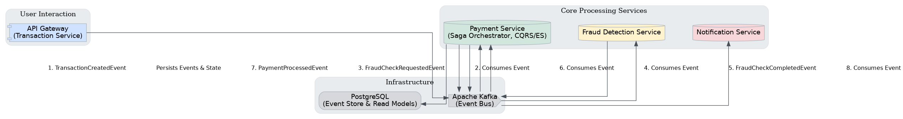
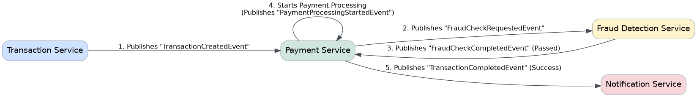

# Real-Time Payment System

[](https://opensource.org/licenses/MIT)

This Java/Spring repository is being developed into a platform for multi-merchant payment orchestration, wallets, balances, and transfers. A single-business installation uses the same architecture with one tenant.

**B1 build and startup passed on 5 November 2026.** A clean local build passed all 51 tests (37 unit and 14 integration). All four packaged services started separately with their test dependencies. The transaction service accepted an HTTP request and published its matching command to Kafka. [B1 startup evidence](docs/development/2026-11-05-b1-service-startup.md)

The B2 payment database migration is in place. The next B2 gate is to bring up the services and infrastructure together from a fresh local environment using Compose. [Payment database evidence](docs/development/2026-11-05-payment-database.md)

Start with the [build and test guide](docs/development/build-and-test.md). The [19 October review](docs/reviews/2026-10-19/README.md) records findings at commit `6bbe4ef`; the [remediation plan](docs/reviews/2026-10-19/remediation-plan.md) defines the ordered work and acceptance gates. Preserve that review as a historical snapshot and use current milestone evidence to assess subsequent changes. The architecture discussion below describes the intended design; the review identifies where implementation and evidence remain incomplete.

## Table of Contents

- [Real-Time Payment System](#real-time-payment-system)
  - [Table of Contents](#table-of-contents)
  - [System Architecture](#system-architecture)
    - [Core Concepts](#core-concepts)
    - [Architectural Deep Dive](#architectural-deep-dive)
  - [Services](#services)
    - [1. Transaction Service](#1-transaction-service)
    - [2. Payment Service](#2-payment-service)
    - [3. Fraud Detection Service](#3-fraud-detection-service)
    - [4. Notification Service](#4-notification-service)
  - [Key Design Patterns and Strategies](#key-design-patterns-and-strategies)
    - [Payment Saga Flow: Orchestration vs. Choreography](#payment-saga-flow-orchestration-vs-choreography)
    - [Reliable Event Publishing Strategy](#reliable-event-publishing-strategy)
    - [Security and Encryption Practices](#security-and-encryption-practices)
  - [Getting Started](#getting-started)
    - [Prerequisites](#prerequisites)
    - [Build and Test](#build-and-test)
    - [Local Infrastructure](#local-infrastructure)
  - [API Documentation](#api-documentation)
  - [Development and Deployment](#development-and-deployment)
    - [Comprehensive Testing Plan](#comprehensive-testing-plan)
    - [CI/CD and Branching Strategy](#cicd-and-branching-strategy)
  - [System Practicality Analysis](#system-practicality-analysis)
  - [License](#license)
  - [Author](#author)

## System Architecture

The repository contains transaction, payment, fraud-detection, and notification services with Kafka integration. Domain-Driven Design, CQRS, and event sourcing guide the intended architecture. Durable publication, recovery, tenant ownership, and financial invariants are explicit remediation work.



### Core Concepts

*   **Event Sourcing**: The `payment-service` uses an event sourcing pattern to persist the state of a transaction. Instead of storing the current state, we store an immutable sequence of events that have occurred. This provides a full audit log and allows the state of an aggregate to be reconstructed at any point in time.
*   **CQRS (Command Query Responsibility Segregation)**: The system separates the responsibility of handling commands (write operations) from handling queries (read operations). This allows for independent scaling and optimization of each path.
*   **Saga Pattern**: `TransactionSagaOrchestrator` coordinates payment events and commands. Completing the workflow, persisting recovery state, and implementing compensations are tracked remediation requirements.
    
*   **Resilience and Fault Tolerance**: The services are built with resilience in mind, using patterns like Circuit Breaker, Retry, and Bulkhead (via Resilience4j) to prevent cascading failures and ensure graceful degradation.

### Architectural Deep Dive

For a deeper understanding of the architectural decisions and patterns used in this project, please refer to the detailed sections later in this document.

## Services

### 1. Transaction Service

*   **Purpose**: The public-facing entry point for all new transactions.
*   **Responsibilities**:
    *   Provides a REST API for creating new transactions.
    *   Performs initial validation on incoming requests.
    *   Creates a `CreateTransactionCommand` and publishes it to the `create-transaction` Kafka topic.
*   **Technologies**: Spring Boot, Spring Web, Kafka, OpenAPI, Resilience4j (RateLimiter).

### 2. Payment Service

*   **Purpose**: The core of the system, responsible for orchestrating the entire payment lifecycle.
*   **Responsibilities**:
    *   Consumes `CreateTransactionCommand` to create the payment aggregate and its `TransactionCreatedEvent`.
    *   Implements the Saga pattern to manage the multi-step transaction process.
    *   Uses Event Sourcing with a JDBC-based Event Store to persist transaction state.
    *   Coordinates with the Fraud Detection Service.
    *   Publishes events to notify other services of the transaction's progress.
*   **Technologies**: Spring Boot, Kafka, Spring Data JDBC, PostgreSQL, Resilience4j.

### 3. Fraud Detection Service

*   **Purpose**: Provides fraud detection capabilities by integrating with external APIs.
*   **Responsibilities**:
    *   Consumes `FraudCheckRequestedEvent`.
    *   Integrates with an external fraud detection API (e.g., Sift Science).
    *   Implements resilience patterns (Circuit Breaker, Retry, TimeLimiter) for external API calls.
    *   Publishes `FraudCheckCompletedEvent` with the result of the fraud check.
*   **Technologies**: Spring Boot, Kafka, Spring WebClient, Resilience4j.

### 4. Notification Service

*   **Purpose**: Handles all user-facing notifications.
*   **Responsibilities**:
    *   Consumes events like `TransactionCompletedEvent` and `PaymentFailedEvent`.
    *   Routes notifications through email, SMS, and webhook adapters. SMTP delivery is verified against a local mail server; provider-specific delivery and durable retries have separate acceptance gates.
    *   Uses a Factory and Strategy pattern to manage different notification types.
    *   Employs an async thread pool for non-blocking I/O operations.
*   **Technologies**: Spring Boot, Kafka, Spring Mail.

## Key Design Patterns and Strategies

### Payment Saga Flow: Orchestration vs. Choreography

This system uses an **Orchestration-based Saga pattern**, with the `TransactionSagaOrchestrator` in the `payment-service` acting as the central coordinator.

**Why Orchestration?**
For a business-critical workflow like payments, orchestration provides:
*   **High Control & Visibility**: A single point to monitor and debug the entire payment flow, making it easy to answer "Where is my money?".
*   **Explicit Process Definition**: The business process is clearly defined in the orchestrator's code, making it easier to understand and modify.
*   **Centralized Error Handling**: The orchestrator is the natural place to implement robust, process-wide error handling and retry logic.

**Compensating Actions:**
The current flow is forward-only. Linked compensating operations and recovery after ambiguous provider outcomes are required parts of the commercial remediation plan.

### Reliable Event Publishing Strategy

`TransactionCommandService` contains an `afterCommit()` publishing callback. The existing repository clears uncommitted aggregate events during save, so the publication sequence still requires repair. An in-memory callback also leaves a recovery gap between a committed database transaction and broker acknowledgement. B4 introduces a transactional outbox, consumer deduplication, and restart tests to establish durable delivery. Transaction intake currently publishes directly to Kafka; durable intake and request idempotency belong to the same milestone.

### Security and Encryption Practices

#### Data in Transit: JWE for External Communication

For securely transmitting sensitive data to external parties like payment gateways, the **JSON Web Encryption (JWE)** standard is recommended.
*   **Library**: **Nimbus JOSE + JWT** is the suggested implementation due to its standards compliance and support for strong cryptographic algorithms.
*   **Best Practices**:
    *   **Key Management**: Never hardcode keys. Use a secure key vault (e.g., HashiCorp Vault, AWS KMS).
    *   **Algorithm Choice**: Use strong algorithms like `RSA-OAEP-256` for key encryption and `A256GCM` for content encryption.

#### Data at Rest: Internal Encryption Utility

The `common` module's `EncryptionUtil` uses `AES/GCM/NoPadding`, creates a random 12-byte IV for each encryption operation, and prepends it to the ciphertext. Key storage, rotation, access control, and integration into actual data flows require their own implementation and verification. The proposed external JWE contract is a separate concern.

## Getting Started

Use the repository wrapper from the repository root. On Windows, [scripts/Test-Backend.ps1](scripts/Test-Backend.ps1) is the preferred test entry point: it runs the wrapper in the visible terminal, forwards Maven arguments and its exit code, and applies the process-scoped temporary-directory workaround for paths containing `&`. The [build and test guide](docs/development/build-and-test.md) explains the test phases, infrastructure requirements, and evidence capture.

### Prerequisites

*   JDK 21, with `JAVA_HOME` and `PATH` selecting that JDK.
*   Git and network access for the initial Maven/dependency downloads.
*   Maven 3.9.9 is selected by Maven Wrapper 3.3.2 in `only-script` mode with a pinned distribution SHA-256; a global Maven installation is optional.
*   A working Docker engine with Linux containers is required for the full integration suite. Docker Compose is used for the separate local infrastructure stack.

### Build and Test

1.  **Clone the repository**:
    ```powershell
    git clone https://github.com/TheAlchemistNerd/Real-Time-Payment-System.git
    Set-Location -LiteralPath '.\Real-Time-Payment-System'
    ```

2.  **Check the toolchain and run unit tests** in a visible PowerShell session:
    ```powershell
    java -version
    javac -version
    .\mvnw.cmd --version
    .\scripts\Test-Backend.ps1 -MavenArguments @('-B', '-ntp', 'clean', 'test')
    ```

3.  **Run the full verification lifecycle** with Docker ready:
    ```powershell
    docker info
    .\scripts\Test-Backend.ps1 -MavenArguments @('-B', '-ntp', '-fae', 'clean', 'verify')
    ```

Compiler 3.13.0 uses Java release 21. Enforcer 3.5.0 accepts Java `[21,22)` and Maven `[3.9.9,4)`; the wrapper selects Maven 3.9.9. Surefire 3.5.2 runs unit classes ending in `Test` during `test`; Failsafe 3.5.2 runs integration classes ending in `IT` during the `verify` lifecycle, which also runs unit tests and packaging. On Linux/macOS, use `./mvnw -B -ntp clean test` or `./mvnw -B -ntp verify`.

Integration tests cover transaction request validation, HTTP intake through the packaged transaction service to Kafka, PostgreSQL persistence and migration, and local SMTP delivery. The payment tests use the same Liquibase changelog and Hibernate schema validation as the payment service. [Payment database setup and evidence](docs/development/2026-11-05-payment-database.md)

### Local Infrastructure

`docker-compose.yml` declares Kafka, ZooKeeper, PostgreSQL, Redis, Prometheus, and Grafana. Application services are started separately; a reproducible assembled application stack belongs to the bootstrap and local-stack milestones. Compose configuration also references database initialization and monitoring files covered by that remediation.

```powershell
docker compose config --services
```

This command inspects the configured service list. Container readiness and application startup require their own executed checks. Integration tests that provision Testcontainers dependencies use Docker directly; the test guide records their requirements separately from Compose.

## API Documentation

The `transaction-service` provides an OpenAPI (Swagger) specification for its API. Once the services are running, you can access the Swagger UI at:

[http://localhost:8080/swagger-ui.html](http://localhost:8080/swagger-ui.html)

From here, you can view the available endpoints and execute API requests to create new transactions.

## Development and Deployment

### Comprehensive Testing Plan

Behavioural repairs begin with a reproduced failing test. The build guide explains how to run unit, integration, and packaged startup checks. Upcoming milestones cover the assembled local stack, provider contracts, recovery, and complete payment journeys. [Build and test guide](docs/development/build-and-test.md) · [B1 startup results](docs/development/2026-11-05-b1-service-startup.md) · [Remediation plan](docs/reviews/2026-10-19/remediation-plan.md)

### CI/CD and Branching Strategy

*   **Local CI**: Run the repository's configured checks locally before each milestone commit and push. The backend entry point is `./mvnw -B -ntp clean verify` with JDK 21 and a working Docker engine, or the Windows helper above. GitHub Actions CI stays disabled unless the owner explicitly requests reactivation. Record failures and unavailable prerequisites; current Maven configuration has no separate lint, security-scan, system-test, or journey-test gate.
*   **Deployment (decision pending)**: Select a staging target and operating budget with the owner, then validate deployment, rollback, recovery, and load against the agreed workload.
*   **Branching**: Develop milestones on feature branches, commit and push after the required local checks, and verify the remote revision. Use the `codex/` prefix for new branches while preserving existing work branches. Keep the acceptance criteria for merging into `main` explicit.

## System Practicality Analysis

The agreed product supports multi-merchant payment orchestration, wallets, balances, and transfers, with single-business operation represented by one tenant. Merchant isolation, ledger invariants, provider reconciliation, and measured operating costs guide the next milestones. Throughput and commercial deployment readiness will be assessed against executed workload and recovery tests after the payment journey is complete.

## License

This project is licensed under the MIT License. See the [LICENSE.md](LICENSE.md) file for details.

## Author

*   **Nevil Maloba**
