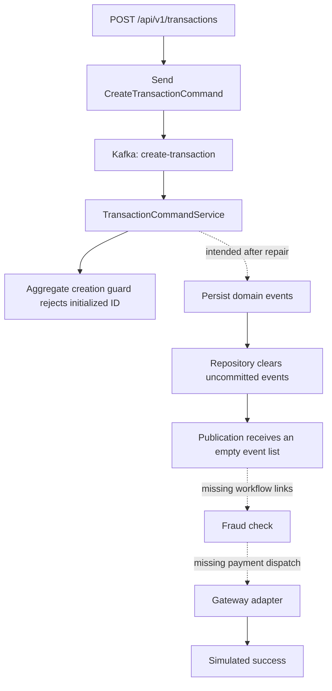

# Backend commercial-readiness review

Review date: 19 October 2026 (Africa/Nairobi). Baseline: [`6bbe4ef9bdf5e396d77ceab55d5c9ac18d8566cf`](https://github.com/TheAlchemistNerd/Real-Time-Payment-System/tree/6bbe4ef9bdf5e396d77ceab55d5c9ac18d8566cf).

## Assessment and agreed scope

The repository provides a useful Java/Spring domain skeleton, but reaching a commercial release requires repairing the executable payment path and adding financial and operational foundations. The baseline fails main-source compilation, and source inspection identifies further startup, event-delivery, workflow, security, and deployment defects. Successful payment processing has not been demonstrated.

The target discussed with the owner combines **multi-merchant payment orchestration** with **wallets, balances, and transfers**. A single-business deployment is a one-tenant configuration of that platform. Wallet accounting is a distinct domain that must be designed and tested explicitly; the existing payment event history is not a wallet ledger.

This review preserves the original application and documentation. It records current evidence and an implementation sequence in [the remediation plan](remediation-plan.md). Statements marked as source findings are deductions from the baseline code, not claims that the services have been run successfully.

## Documentation coverage

All four tracked Markdown files were read in full: 588 lines in total. All three tracked diagrams were visually inspected. The remaining tracked text files were inspected to reconcile the documentation with the implementation, including all 101 Java files, six Maven POMs, application and test configuration, SQL, Dockerfiles, Compose, and `.gitignore`. The baseline has 126 tracked files. [review-coverage.json](review-coverage.json) records the baseline paths, line counts, sizes, and SHA-256 hashes.

| Document or diagram | Coverage | What it contributes | Reconciliation with current code |
| --- | --- | --- | --- |
| `README.md` | Lines 1–207 | Architecture, services, saga, event publication, encryption, setup, test and deployment strategy | Intake now publishes a command; encryption already uses AES-GCM; Compose starts infrastructure only. Testing and CI/CD descriptions are intentions, not evidence of a working release. |
| `payment-service/docs/payment_flow_documentation.md` | Lines 1–239 | Command/aggregate boundary, gateway adapters, proposed authorization/capture, tokenization, reconciliation, idempotency, inbound webhooks | Command-based intake is current. The described robust end-to-end flow is incomplete. The actual gateway call uses `.block()`. Both gateway adapters simulate success. Future capabilities remain proposals. |
| `notification-service/notification-service notes.md` | Lines 1–121 | Proposed durable, general-purpose pub/sub notification service and four migration phases | Typed event listeners and provider-specific classes now exist. The webhook adapter performs HTTP requests, but SMTP, SMS, and SendGrid still simulate delivery. The claimed `/send` endpoint is absent. Persistence, subscriptions, and delivery workers remain proposed. |
| `LICENSE.md` | Lines 1–21 | MIT license and copyright notice | Preserved as supplied. |
| `docs/images/system_architecture.png` | Visually inspected | Four services, Kafka, PostgreSQL, CQRS/event sourcing | Conceptual topology; no implemented gateway authentication or tenant boundary. |
| `docs/images/payment_saga_flow.png` | Visually inspected | Transaction, payment, fraud, notification relationships | Represents intended flow; missing producer/consumer links prevent this flow in current code. |
| `docs/images/testing_pyramid.png` | Visually inspected | Unit, integration, and end-to-end testing balance | Testing strategy, not execution results. |

The README refers to additional analysis documents and a detailed testing plan, but no separate files with those contents are tracked at this baseline. There are no tracked CI workflows, database changelogs, monitoring configuration, or initialization scripts despite references to some of them in configuration.

## Executed checks

| Check | Observed result | Interpretation |
| --- | --- | --- |
| Repository clone and remote HEAD | Cloned the canonical GitHub URL into the workspace; HEAD `6bbe4ef` on `main` | Source baseline established. |
| Java | Eclipse Temurin 21.0.10 available | A Java 21 compiler is available locally. |
| Maven | Maven 3.9.9 downloaded into a temporary tools directory; archive SHA-512 verified against Maven Central | No global Maven installation or application-source changes were needed. |
| `mvn -B -ntp -Dmaven.test.skip=true package` | Exit 1. Parent, `common`, and `transaction-service` succeeded; `payment-service` failed at `TransactionCommandService.java:121,131,146` because `getNotificationType()` does not exist. Fraud and notification modules were skipped by the reactor. | Main compilation failure is executed evidence. Tests were explicitly skipped in this packaging baseline. |
| Packaged transaction-service JAR | Manifest has no `Main-Class`; archive has no `BOOT-INF/` entries | The produced artifact is a plain JAR, not the executable Spring Boot artifact assumed by the Docker launch command. |
| `docker compose config --services` | Parsed successfully; listed `grafana`, `zookeeper`, `kafka`, `postgres`, `prometheus`, `redis`; warned about unset database/Grafana variables | Compose contains no application services. Parsing does not validate that images, mounts, or services work. |
| Docker engine | Initial query failed because the `dockerDesktopLinuxEngine` pipe was unavailable | Container-backed integration and end-to-end validation remain outstanding. |
| Source/test review | All tracked application and test sources inspected | Source-level findings below; no passing test-suite or throughput claim. |

[baseline-build.txt](baseline-build.txt) preserves the build outcome and compiler diagnostics with the machine-specific workspace prefix normalized.

## Current payment path

The source also contains a main-compilation failure before this runtime path can execute. The diagram illustrates independent defects that remain after that compilation failure is repaired.

## Findings and concrete remedies

P0 denotes a prerequisite for a working, trustworthy payment path or financial platform. P1 denotes a requirement for an operational pilot. Source locators below refer to the baseline commit, using repository-relative paths and one-based line numbers.

### F01 — P0: Restore a reproducible build

**Executed:** `payment-service/.../service/TransactionCommandService.java:121,131,146` calls `aggregate.getNotificationType()`, but the aggregate has no corresponding field or accessor. The root POM targets Java 17 while payment-service targets Java 21 and uses pattern matching in switches. Docker runtimes target Java 17. Test sources also refer to obsolete command packages and constructors.

**Remedy:** choose one Java baseline, pin compiler/test plugin versions, add a Maven wrapper, reconcile the notification contract, and run compilation and test compilation for every module. Explicitly configure executable Spring Boot packaging and verify the resulting JARs. Keep these changes on an isolated implementation branch.

### F02 — P0: Repair Spring application wiring

**Source:** `transaction-service/.../TransactionServiceApplication.java:9` scans `com.paymentProcessor.common`, but the actual package is lowercase `com.paymentprocessor.common`. `common/.../util/TransactionIdGenerator.java:5` has no component annotation or registered bean. `payment-service/.../service/TransactionQueryService.java:17–19` likewise has no component stereotype, despite constructor injection into its controller. The query repository uses `SELECT T` with alias `t` at line 20.

**Remedy:** register required dependencies explicitly, correct package scanning and JPQL, and require real application-context startup tests for every service.

### F03 — P0: Fix transaction creation semantics

**Source:** `TransactionCommandService.java:49–50` constructs `new TransactionAggregate(transactionId)` and calls its create handler. `TransactionAggregate.java:54–59` sets that ID, while `validateNewTransaction()` at lines 185–188 rejects any non-null ID.

**Remedy:** distinguish an uninitialized aggregate from an existing event stream using a consistent state/version invariant. Test initial creation, reconstruction, duplicate create commands, and conflicting concurrent creates.

### F04 — P0: Persist events and publication intent atomically

**Source:** `TransactionAggregateRepository.java:29–31` saves and clears uncommitted events. Its caller then invokes `publishEventsAfterCommit()` (`TransactionCommandService.java:51–52,73–74,136–137`), which copies the now-empty list at line 165. Even with that order repaired, an in-memory `afterCommit` callback leaves a database-commit-to-Kafka delivery gap. Publication failures are logged without durable retry.

**Remedy:** write the domain state/events and outbox entries in one database transaction; publish with a restartable worker; record attempts and delivery state; make each consumer idempotent. Keep aggregate sequence ordering explicit. This addresses the dual-write problem described in [AWS's transactional outbox guidance](https://docs.aws.amazon.com/prescriptive-guidance/latest/cloud-design-patterns/transactional-outbox.html).

### F05 — P0: Complete the workflow and topic contracts

**Source:** production code never constructs a `FraudCheckRequestedEvent` or a `ProcessPaymentCommand`. `TransactionSagaOrchestrator.java:36–42` comments claim follow-on events are generated, but the aggregate fraud handler only applies `FraudCheckCompletedEvent`. `TransactionCommandService.java:188–196` routes most events to `payment-events`; the projection listens on `transaction-events`, and saga/notification listeners expect `payment-processed` or `payment-failed`.

**Remedy:** specify one event/command routing table, implement every transition, centralize topic configuration, and test creation through fraud to success, decline, failure, and timeout. Persist saga progress, deadlines, and recovery decisions. Represent fraud-result input separately from the aggregate's recorded decision to avoid a self-consuming result loop when routing is repaired.

### F06 — P0: Define consistent terminal transitions and replay

**Source:** `TransactionCommandService.java:116–124` applies `TransactionCompletedEvent`, but the aggregate switch (`TransactionAggregate.java:174–181`) has no handler for that event. A successful gateway response would therefore throw. Public `apply()` accepts state changes without command-level transition validation. Process-payment amount is taken from the incoming command without verifying equality to the aggregate's amount.

**Remedy:** make the aggregate own guarded outcomes, enforce transaction identity and immutable money fields, and define which events belong in its stream. Require deterministic replay and duplicate/out-of-order outcome tests. Give refunds, reversals, cancellations, pending outcomes, and timeouts explicit semantics.

### F07 — P0: Establish authoritative database migrations

**Source:** `payment-service/src/main/resources/schema.sql` is missing a comma after `risk_score` (line 22), has a malformed index name (line 28), omits the entity's `currency` column, and allocates only three characters for values such as `CREDIT_CARD`. Configuration references an absent Liquibase changelog; the dependency is absent too. Payment config uses `payment_db`/`DB_USERNAME`; Compose creates `payment_system`/`DB_USER`. JPA is configured to validate the schema.

**Remedy:** adopt one migration tool, align configuration and schema, initialize a fresh PostgreSQL database deterministically, and test upgrades from the previous release. Preserve event uniqueness constraints and map concurrent append conflicts to retryable domain conflicts. Use explicit UTC-aware time semantics.

### F08 — P0: Build an actual deployment package

**Source:** `transaction-service/Dockerfile` is empty. Compose defines infrastructure only, references untracked `init-scripts` and `monitoring/prometheus.yml`, and advertises Kafka as `localhost:9092`. Other Dockerfiles use Java 17 while payment requires 21; the payment health check assumes `curl` is installed. Several images use `latest`.

**Remedy:** provide executable images for all application services, a complete development Compose file, correct internal/external broker listeners, environment examples, pinned compatible images, dependency readiness checks, and startup verification from a fresh checkout. Decide the production hosting target separately and validate its deployment manifests.

### F09 — P0: Add authenticated tenant and merchant boundaries

**Source:** no authentication/security dependency, filter chain, authorization checks, tenant model, or merchant-scoped persistence is present. Intake accepts a caller-supplied `userId`; payment queries include unrestricted user, date-range, and aggregate-summary endpoints (`PaymentQueryController.java:34–119`).

**Remedy:** derive tenant/actor identity from authenticated credentials, define roles and service identities, and scope every command, event, record, query, provider account, and delivery destination. Test cross-tenant access denial. Model a single-business installation as one tenant using the same controls.

### F10 — P0: Implement business-operation idempotency

**Source:** intake creates a fresh ID on every request and returns acceptance before broker acknowledgement (`TransactionService.java:51–75,114–123`). There is no durable request key, request fingerprint, provider-operation key, or consumer inbox. Kafka producer idempotence does not deduplicate repeated business requests.

**Remedy:** persist tenant-scoped idempotency keys and request hashes, replay the original result for the same request, reject key reuse with different content, and give each external operation a stable provider key. Return acceptance only after durable receipt. [Stripe's idempotency contract](https://docs.stripe.com/api/idempotent_requests) is one provider-specific reference; each adapter must implement its provider's actual semantics.

### F11 — P0: Replace simulated money movement with a verified provider adapter

**Source:** `StripeClient.java:14–25` and `PayPalClient.java:14–25` return hardcoded successes and fabricated identifiers. `TransactionCommandService.java:96–104` supplies dummy card details. Refund methods are stubs without an exposed, persisted refund workflow. No inbound provider webhook endpoint exists.

**Remedy:** implement one explicitly selected provider in sandbox first, accept provider-issued payment-method references, persist attempts and provider references, and process signed callbacks through a durable inbox. Reconcile ambiguous outcomes before another charge attempt. Provider webhooks can arrive more than once and out of order; [Stripe documents these behaviours and signature verification](https://docs.stripe.com/webhooks).

### F12 — P0: Separate external I/O from database transactions

**Source:** the transactional payment handler holds the operation open across `gateway.processPayment(...).block()` (`TransactionCommandService.java:85–152`). Real asynchronous adapters may execute callbacks on another thread, outside the imperative transaction context. A provider success followed by a local database error leaves an unresolved external side effect; an error signal can also roll back the locally recorded failure.

**Remedy:** durably create an attempt, commit, execute the provider call with a stable key, and record its outcome in a separate short transaction. Add an explicit unknown/reconciliation state. Test a process crash immediately after provider success and before local persistence.

### F13 — P0: Make fraud outcomes explicit and recoverable

**Source:** both `ExternalFraudApiClient.java:64–75` and `FraudDetectionService.java:112–122` turn service failures into approval. `REVIEW` can pass the service's decision check. Fraud requests hardcode USD, intake metadata is dropped from the create command, and the authorization header is constructed as `Bearer` immediately followed by the key. Result publication is asynchronous and its completion is not part of the returned processing future.

**Remedy:** define APPROVE, DECLINE, REVIEW, and UNAVAILABLE outcomes with a merchant policy, preserve currency and trusted request metadata, validate the real provider contract, and durably publish the result before acknowledging completion. Add tests for provider errors, invalid response data, delayed responses, and retry exhaustion.

### F14 — P0: Repair notification startup and honest delivery status

**Source:** notification configuration starts with `erver:` instead of `server:` and lacks Kafka serializers/manual-ack configuration. `EmailNotificationService` is an unconditional bean, but `NotificationServiceFactory.java:25–33` does not recognize its type. SMTP, SMS, and SendGrid implementations report success without sending; the factory test registers two EMAIL implementations and creates a duplicate map key.

**Remedy:** make provider selection explicit, remove or retire the obsolete duplicate adapter, validate configuration on startup, wire typed Kafka consumption and acknowledgement, and report delivery based on actual provider results. Keep simulation adapters in an explicit test/development profile.

### F15 — P1: Make notification delivery durable and constrain destinations

**Source:** notification listeners acknowledge on both failure and success; their futures are not backed by a delivery-task store. The webhook sender posts to a user-provided URL without destination controls or signatures (`WebhookNotificationService.java:56–79`). Error handlers return `false`, so an exception-based retry annotation alone cannot provide the intended delivery policy. Recipient lookup is mocked.

**Remedy:** persist delivery tasks, use leased workers and scheduled backoff, record attempts, provide dead-letter inspection/redrive, and deduplicate by event and subscription. Register tenant-owned HTTPS endpoints, restrict private/link-local destinations and redirects, sign outgoing payloads, and implement real contact lookup.

### F16 — P0: Add the wallet and ledger domain

**Source:** no ledger accounts, journal entries, balances, holds, transfers, funding, withdrawals, fees, or settlement/reconciliation models are tracked. Payment status events alone do not establish financial balances.

**Remedy:** introduce an immutable double-entry journal, balanced postings per currency, account ownership, available/reserved balances, atomic internal transfers, and compensating entries for reversals. Reconcile provider clearing positions against journal entries and settlements. The remediation plan specifies invariants and acceptance tests before wallet release.

### F17 — P1: Preserve currency and reporting correctness

**Source:** the domain allows multiple currencies including JPY, but intake and SQL universally assume two decimal places. `TransactionReadModelRepository.java:29–32` sums amounts without grouping by currency or tenant; `TransactionQueryService.java:55–63` returns one unqualified total. Notification text prefixes amounts with a dollar sign. Timestamps use local time without zone information.

**Remedy:** define a Money type with explicit currency and exponent rules, configure launch currencies, use UTC instants plus business reporting zones, and group financial reports by tenant and currency. Bound pagination and date ranges. Keep FX as an explicit quoted conversion operation if introduced.

### F18 — P1: Finish operational and secret-handling controls

**Source:** SendGrid logs its API key (`SendGridEmailService.java:40`); mail debug output is enabled. Common AES-GCM encryption already exists, contrary to the README's ECB finding, but key rotation/envelope management and its production use are not established. Health endpoints return static healthy responses; traces are not propagated through commands/events. The rate-limit annotation names a fallback method that is absent and uses a differently cased instance name from YAML. CI, recovery runbooks, and backup/restore evidence are absent.

**Remedy:** redact credentials, externalize secrets, restrict management endpoints, verify resilience configuration under load, add dependency-aware readiness and correlated traces, and alert on financial invariants, stuck workflows, oldest outbox age, delivery backlog, and reconciliation differences. Exercise backup restoration and operational recovery.

### F19 — P1: Replace stale tests with executable release gates

**Source:** transaction tests expect `transaction-created` and `SUCCESS`, while production sends `create-transaction` and returns `PENDING`. Payment tests import the removed `com.paymentprocessor.payment.command` package and use old constructors; an integration test mixes JUnit 4 and a missing test-properties resource. Fraud tests contain a missing parenthesis and an invalid local-record declaration. SMTP assertions that verify actual sending are commented out. No Testcontainers-based end-to-end flow is implemented.

**Remedy:** align tests to the public contract, prove all service contexts start, and run PostgreSQL/Kafka integration tests plus provider-stub contract tests. Add duplicate delivery, ordering, concurrent spending, tenant isolation, provider timeout, crash recovery, migration, and restore scenarios. Treat compiled or mocked success as narrower evidence than a completed sandbox payment.

## Immediate implementation sequence

1. Restore build, test compilation, service startup, schema migrations, and executable packaging.
2. Repair one complete payment flow with durable intake, explicit state transitions, transactional outbox/inbox, and repeatable failure tests.
3. Add authenticated tenant/merchant ownership and the ledger foundation before exposing multi-merchant or wallet APIs.
4. Integrate one real provider in sandbox, including callbacks and reconciliation; implement wallet funding and withdrawal against verified outcomes.
5. Finish delivery durability, operational controls, deployment automation, and measured pilot acceptance.

The detailed [remediation plan](remediation-plan.md) records acceptance criteria and decisions that influence implementation. This snapshot establishes the starting point; it does not certify deployment or financial correctness.
