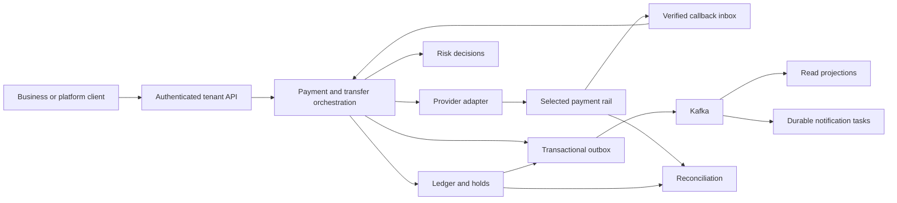

# Remediation plan: payments, merchants, wallets, and transfers

Date: 19 October 2026. Status: proposed implementation plan based on the [baseline review](README.md). The owner selected a combined multi-merchant payment platform and wallet/transfer platform. Single-business operation is a one-tenant configuration.

## Product boundary

The first complete release should provide authenticated merchant APIs, provider-backed collection, a transaction history, a wallet ledger, internal transfers, funding and withdrawal workflows, reconciliation, and reliable merchant notifications. Select a narrow initial market, currency set, and payment rail so each lifecycle can be proven end to end.

Use explicit capability flags for merchants that only need checkout, merchants with stored balances, and merchants with payout/transfer capabilities. Provider coverage and the operating arrangement for held funds remain product decisions. Record the settlement-account owner, funding source, account limits, identity-verification workflow, and responsible operations team before enabling live wallet funding or payouts. Geography and provider availability should drive the first adapter; the presence of a Stripe-named stub is not a provider selection decision.

## Architecture direction

Retain useful domain boundaries: transaction intake, payment orchestration, risk decisions, and notifications. Add a clearly owned ledger and tenant/merchant domain. Keep the financial write path within one transactional boundary initially; maintain logical modules without requiring every new domain to become a separate network service. Existing service boundaries can be retained during repair, with deployment consolidation evaluated explicitly if operational cost warrants it.

Kafka carries integration events. PostgreSQL owns durable operation state, inbox/outbox records, financial journal entries, and delivery tasks. Redis, if retained, supports optional caching or quotas; balance correctness belongs to the ledger transaction. Separate workflow state, immutable financial postings, and read projections so replaying a projection never repeats an external charge or journal posting.

## Financial and delivery invariants

| Invariant | Required evidence |
| --- | --- |
| Every posted journal balances per currency | Property-based tests and database-transaction tests reject unbalanced postings. |
| A business operation has at most one financial effect | Concurrent retries with the same tenant-scoped key return the same result; changed payloads conflict. |
| A transfer is atomic | Debit and credit commit together; a crash or failed constraint leaves neither side posted. |
| Available funds are checked atomically | Concurrent spending tests prove holds/transfers cannot exceed the approved balance or explicit credit policy. |
| Posted history remains auditable | Corrections create linked reversal/adjustment entries; existing postings remain intact. |
| Tenant ownership is enforced everywhere | Negative tests cover APIs, asynchronous consumers, provider accounts, journals, exports, and delivery endpoints. |
| Payment outcomes distinguish uncertainty | A timeout after provider acceptance enters reconciliation; retry never silently creates a new operation. |
| Provider callbacks are verified and deduplicated | Invalid signatures are rejected; repeats and reordered events converge on the same valid state. |
| Database state and publication intent commit together | Kill/restart tests show committed outbox entries are recoverable and rolled-back changes publish nothing. |
| Projections are rebuildable | Replaying events reconstructs views without replaying money movement or merchant delivery. |
| Wallet availability follows a defined funding policy | Tests distinguish provider authorization, capture, settlement, reversibility, holds, and spendable credit. |
| Financial totals retain tenant and currency | Reports never combine unlike currencies into an unqualified total. |

## Ordered work packages and acceptance gates

| Package | Concrete changes | Acceptance gate | Dependencies |
| --- | --- | --- | --- |
| B1: Build and bootstrap | Java alignment, Maven wrapper/plugins, compile errors, obsolete tests, Spring bean registration, configuration validation, executable JARs | Clean checkout compiles and all service context tests run; each JAR starts with its required test dependencies | Baseline review |
| B2: Database and local stack | Versioned migrations, matching entities/configuration, complete Dockerfiles and Compose, pinned images, internal broker listeners, health checks, example environment | Empty local environment starts deterministically; migrations validate; an upgrade path preserves data | B1; working Docker host |
| B3: Payment state machine | Creation invariant, explicit fraud dispatch/results, gateway dispatch, terminal events, timeout/review states, topic contracts | A controlled provider stub supports complete success, fraud decline, provider decline, and timeout paths | B1–B2 |
| B4: Durable execution | Durable intake, request idempotency, attempt records, outbox/inbox, consumer deduplication, durable saga progress, projection sequence checks | Restart/crash/duplicate tests produce one business effect and eventually consistent views | B3 |
| B5: Identity and merchants | Authenticated principals, tenants, merchants, roles, service credentials, ownership constraints, scoped reporting, endpoint registration | One-tenant and two-tenant tests pass; all cross-tenant access tests fail as designed | B1–B2; schema design coordinated with B4 |
| B6: Money and ledger | Currency rules, ledger accounts, journal/postings, holds, atomic transfers, reversals, fee accounts, audit history | Balance invariants and concurrent-transfer tests pass against PostgreSQL; complete ledger rebuild agrees with balances | B4–B5 |
| B7: Provider sandbox | One real collection adapter, payment-method tokens, stable provider operation keys, signed callback inbox, provider status polling, refunds | Actual sandbox creation, callback, duplicate retry, refund, and uncertain-outcome reconciliation pass | B4–B6; provider selection and sandbox access |
| B8: Wallet lifecycle | Funding, availability policy, withdrawal holds, payout attempts, payout reversal, limits, manual review, merchant settlement | Funding and payout results reconcile to ledger/clearing accounts; failed payouts release or reverse the correct reservations | B6–B7 |
| B9: Durable communications | Delivery-task persistence, provider adapters, signed webhooks, retry schedule, destination controls, dead-letter inspection/redrive | Delivery survives restart; duplicate inputs are deduplicated; timeout and endpoint-failure policies behave as specified | B4–B5 |
| B10: Operations and release | CI gates, artifact scanning, environment separation, secrets rotation, deployment manifests, telemetry, alerts, runbooks, backup/restore | Staging deployment, rollback/forward recovery, restore, load/soak, and fault scenarios pass with recorded results | B1–B9 |

Packages are implementation units, not calendar estimates. Record elapsed work and measured bottlenecks after B1–B4 before making a delivery forecast. Parallelize independent work after contracts and database ownership are settled.

## First implementation slice

The first application-changing branch should make the repository build and boot without claiming production readiness. Deliver:

1. A consistent Java toolchain, wrapper, explicit packaging, and test runner.
2. Correct command/event DTOs and aggregate initialization, including notification preference handling.
3. Working dependency injection for transaction, payment, fraud, and notification services.
4. A versioned PostgreSQL schema and aligned configuration.
5. A complete local stack with deterministic fake provider and mail endpoints under a development/test profile.
6. Tests that demonstrate creation through a completed or declined transaction, with preserved events and a queryable result.

Durability, tenant isolation, and ledger design should be specified during this slice and completed before any live-money integration. Keep commits small enough to review and label each validation result as unit, integration, provider sandbox, or staging evidence.

## Proposed core records

| Domain | Initial records | Critical constraints |
| --- | --- | --- |
| Identity and ownership | Tenant, merchant, actor, role, API credential, provider account | Every business resource has an owner; credentials bind to explicit scopes and environment. |
| Payment workflow | Payment intent, payment attempt, provider reference, refund, saga progress | Immutable tenant/money identity; versioned state transitions; unique operation references. |
| Durable messaging | Intake receipt, outbox event, consumer inbox, callback inbox | Unique consumer/event and tenant/operation keys; payload hash; causation/correlation IDs; schema version. |
| Ledger | Ledger account, journal transaction, posting, balance snapshot | Balanced postings per currency; immutable journal; atomic sequence/version updates. |
| Wallet | Wallet, hold, transfer, funding request, withdrawal request | Owner/currency consistency, atomic availability checks, linked journal IDs and provider references. |
| Operations | Reconciliation run, statement item, discrepancy, manual-review decision | Evidence and actor attribution; auditable resolution; repeatable imports. |
| Communications | Registered endpoint, subscription, delivery task, attempt | Tenant-owned destinations; event/subscription uniqueness; scheduled retry and retention. |

A payment intent represents the customer's intended operation. A payment attempt represents one controlled interaction with a provider. A journal transaction represents financial postings. These have different identities and lifecycles even when they share an operation reference.

## Required scenarios before a pilot

- Normal collection, fraud decline, provider decline, customer action required, and delayed confirmation.
- Concurrent duplicate create/refund/transfer requests; reused idempotency key with a different body.
- Provider timeout after acceptance, followed by process restart and successful reconciliation.
- Kafka unavailable after database commit; outbox worker restart; duplicate and reordered deliveries.
- PostgreSQL restart during a transfer; simultaneous holds; insufficient available balance; reversal after settlement.
- Valid and invalid callback signatures; duplicate callbacks; tenant/provider-account mismatch.
- Cross-tenant reads/writes, scoped administrative actions, credential rotation, and revoked access.
- Notification endpoint timeout, private-address destination rejection, retry exhaustion, and controlled redrive.
- Fresh migrations, upgrade migrations, restored database plus replay, and recovery from a corrupt projection.
- Measured sustained and burst traffic on the selected hosting target, including latency, resource use, backlog recovery, and external-provider limits.

Choose numerical throughput, latency, availability, recovery-time, recovery-point, retention, and budget targets with the owner before the pilot. A numerical target should be supported by a workload and environment specification rather than inferred from the word “real-time.”

## Decisions still needed for implementation

| Decision | Why it changes implementation | Working approach |
| --- | --- | --- |
| Launch market and currencies | Provider availability, currency precision, reporting and identity workflows | Select a small explicit launch set; keep currency metadata extensible. |
| First collection and payout rail | Callback contracts, timeout behaviour, settlement files, reversals | One fully verified sandbox integration before multi-provider routing. |
| Wallet funding/holding arrangement | Account ownership, availability, payout controls and reconciliation | Make the operating arrangement explicit in the domain and provider contracts. |
| Internal transfers versus external remittances | Atomic ledger posting versus an external payout workflow | Start with same-currency internal transfers; model external transfers as separate operations. |
| Hosting and operating budget | Managed versus self-hosted data services and deployment complexity | Validate locally first; choose one staging target before production manifests. |
| Merchant roles, limits, and operator approvals | Authorization and financial workflow rules | Define per-tenant policies and auditable operator actions. |

The general-purpose notification platform described in the original notes can follow the payment release. Durable payment notifications belong in the first release; broad topic/subscription self-service and unrelated product domains can be added once the core delivery machinery is proven.
